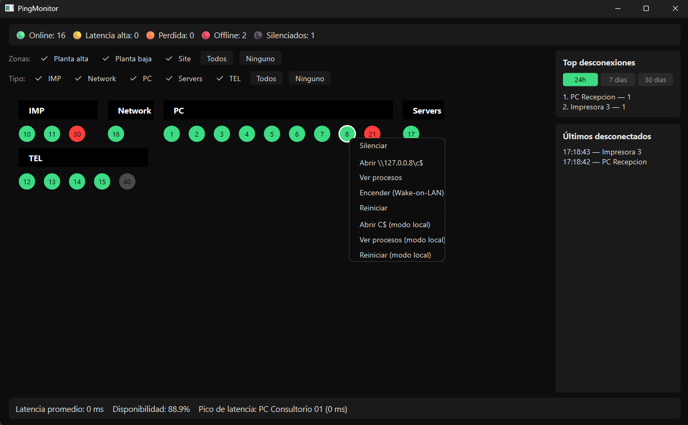
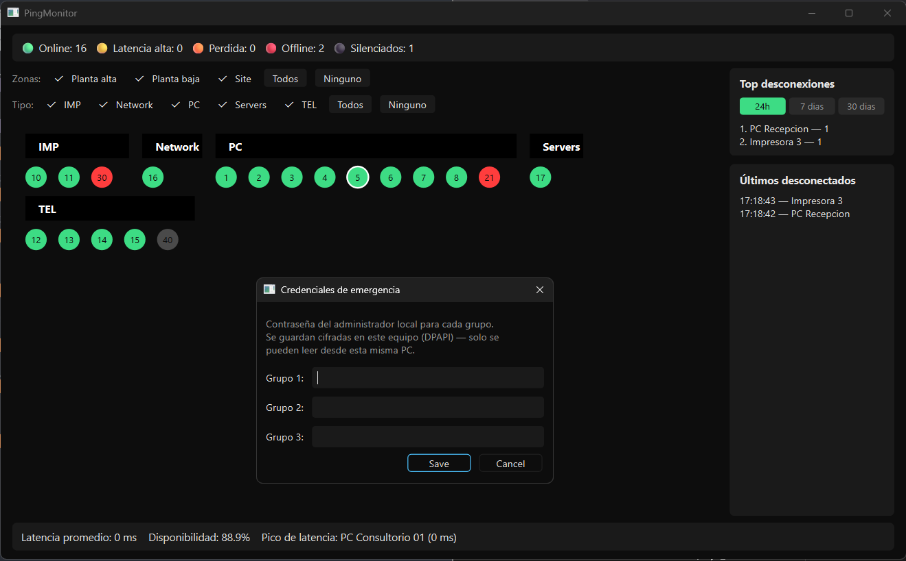
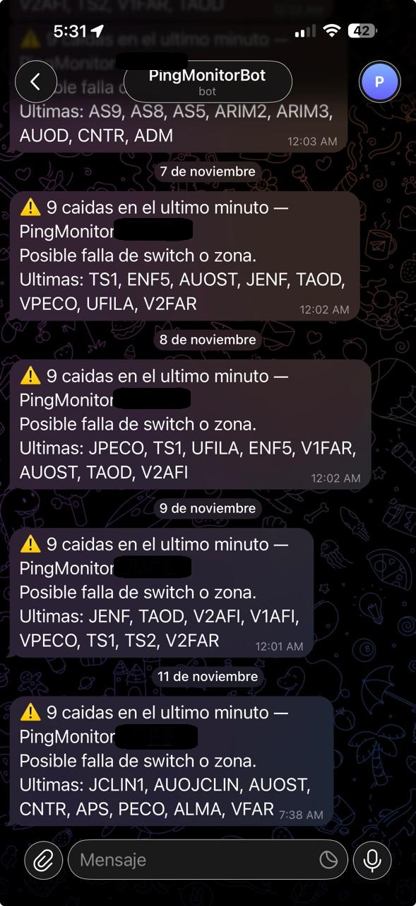
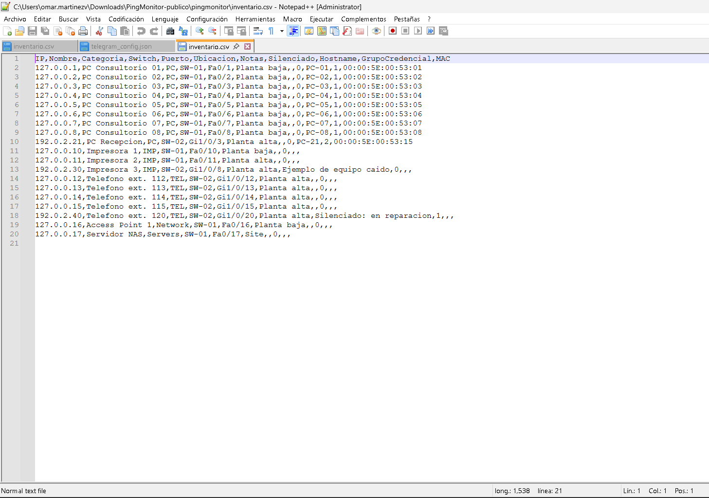

# PingMonitor

A lightweight Windows desktop app that monitors network devices in real time using **native ICMP calls** — no admin rights, no external ping binaries, no agents.

Built and used in production by a single IT administrator to watch a fleet of **160+ devices** (workstations, printers, IP phones, switches, servers) at a public healthcare facility.


*Demo data. Green = online, red = confirmed down, grey = muted. Right-click menu open on a workstation.*

---

## Why I built it

As the only IT person on site, I needed to know *which* device went down *before* users called — and to tell a real outage apart from a single dropped packet. Generic ping tools either needed admin rights, flooded me with false alarms, or kept no history, while full monitoring suites such as PRTG, SolarWinds or Nagios were far more than a single-site team needed. PingMonitor solves those three problems in one small executable, tailored to my specific needs.


---

## Features

### 1. Live status grid

Every device is a circle labeled with the last octet of its IP, grouped under a header per category. The grid refreshes every **3 seconds**.

| Color | State | Rule |
|---|---|---|
| 🟢 Green | Online | Answers normally |
| 🟡 Yellow | High latency | Answers, but slower than **100 ms** |
| 🟠 Orange | Packet loss | Answers now, but **≥ 20 %** of its last 10 pings failed |
| 🔴 Blinking red | Confirming | Just failed a ping — not yet considered down |
| 🔴 Red | Offline | **3 consecutive failures** — a confirmed outage |
| ⚫ Grey | Muted | Still pinged and logged, but never alerts |

The confirming state is the key to avoiding false alarms: one lost packet makes a circle blink, but only a sustained failure turns it solid red and triggers alerts.

**Hover** over any device to see its name, IP, current latency, last outage and uptime.

### 2. Filters

- **Zones** (from the `Ubicacion` column) and **Types** (from `Categoria`) can be toggled independently, with *All* / *None* shortcuts.
- The counters and statistics always reflect the current filter.

### 3. Status bar and statistics

- **Top bar:** live count of devices online, with high latency, with packet loss, offline and muted.
- **Bottom bar:** average latency, **availability %** (responding devices ÷ active devices — slow or lossy devices still count as available; muted ones are excluded) and the device with the highest latency right now.

### 4. Outage history

- **Top disconnections** panel: devices with the most outages in the last **24 h, 7 days or 30 days**.
- **Latest disconnections** panel: the most recent outages with their exact time.
- **Double-click** a device to open its history window: availability and every DOWN → UP event with timestamp and duration. Outages that happened while the device was muted are shown dimmed and do not count against its availability.
- Everything is stored in **SQLite**. If the app was closed while a device was down, the open event is resumed on the next start instead of being duplicated, so the recorded duration is real.

### 5. Right-click actions

The menu adapts to the device category (see the screenshot above):

| Action | Available for | What it does |
|---|---|---|
| Mute / Unmute | All devices | Stops alerts for a device under repair. The state is saved to the CSV and survives restarts. |
| Open in browser | `IMP` (printers), `TEL` (IP phones) | Opens `http://<ip>` — the device's web admin page. |
| Open `\\ip\c$` | `PC` | Opens the remote administrative share in Explorer using the current domain session. |
| View processes | `PC` | Opens a PowerShell window listing the remote PC's processes, sorted by memory use. |
| Wake-on-LAN | `PC` | Sends a magic packet to the subnet broadcast. Enabled only when the PC is **not** responding. |
| Restart | `PC` | Restarts the remote PC after a confirmation dialog whose default answer is *No*, so an accidental Enter never reboots anything. Enabled only when the PC **is** responding. |

### 6. Emergency mode (local administrator account)

When domain authentication fails — a broken trust relationship, the PC off the domain — the bottom three menu entries repeat *Open C$*, *View processes* and *Restart* using the PC's **local administrator** account instead.

<p align="center">
  
</p>

- Workstations are assigned to one of **three credential groups** (`GrupoCredencial` column), matching how local admin passwords are managed in the fleet.
- The first time a group is needed, the app asks for its password once.
- Passwords are stored **encrypted with Windows DPAPI** in machine scope: the file is unreadable if copied to another computer. See [Security notes](#security-notes).

### 7. Alerts

- **Sound alert** on every confirmed outage, with an **8-second cooldown** so a switch failure taking down 30 devices does not produce 30 beeps.
- **Telegram alert** when **more than 8 devices fail within 60 seconds** — the signature of a switch or zone failure rather than a single device. It fires once per storm and re-arms only after the count drops back down.

<p align="center">
  
</p>

*Real alerts from production, received on consecutive days.*

### 8. Inventory-driven

All devices live in a plain CSV file, easy to edit or generate from an existing asset spreadsheet.



| Column | Required | Description |
|---|---|---|
| `IP` | yes | Device address |
| `Nombre` | | Display name |
| `Categoria` | | Group shown in the grid. `PC`, `IMP` and `TEL` enable the extra right-click actions; any other name is display-only. |
| `Ubicacion` | | Location, used by the zone filter |
| `Switch`, `Puerto` | | Where the device is connected (reference for the admin) |
| `Notas` | | Free text |
| `Silenciado` | | `1` = muted |
| `Hostname`, `GrupoCredencial` | | Needed only for emergency mode |
| `MAC` | | Needed only for Wake-on-LAN |

---

## How it works

```
┌──────────────────────┐   Qt signals    ┌──────────────────────────┐
│ PingWorker (QThread) │ ──────────────▶ │ Main window (GUI thread) │
│  IcmpSendEcho via    │  host updated   │  grid · stats · alerts   │
│  ctypes, every 3 s   │  outage / up    └────────────┬─────────────┘
└──────────────────────┘                              │
                                                      ▼
                                            SQLite (historial.db)
```

- **Native ICMP:** `ping_engine.py` calls `IcmpCreateFile` / `IcmpSendEcho` from `iphlpapi.dll` through `ctypes`, reusing a single handle for the life of the scan thread. Unlike raw-socket libraries, this does **not** require running as administrator.
- **Threading:** pings run in a `QThread`; results reach the GUI through Qt signals (queued connections), so all SQLite access happens on one thread with no manual locking.
- **No extra dependencies:** apart from PySide6, everything uses the Python standard library and native Windows DLLs (`iphlpapi`, `crypt32`, `mpr`).

## Security notes

- **Local admin passwords are encrypted with DPAPI** (`CryptProtectData`, machine scope).
- **Passwords never appear on a command line.** An earlier version passed the password as a process argument (`net use …` and an inline PowerShell `SecureString`), which exposed it in the process list and, potentially, in PowerShell script-block logs. I identified and fixed this:
  - `C$` connections now call the Win32 API `WNetAddConnection2W` directly — no child process at all.
  - PowerShell actions receive the password through an environment variable that exists only in the child process and is deleted by the script as soon as it is read; the visible command contains only the variable *name*.
  - Details and the remaining known limitation are documented in [`conexion_segura.py`](conexion_segura.py).
- Real inventory, history, credentials and Telegram settings are excluded from the repository by `.gitignore`.

## Requirements

- Windows 10 / 11
- Python 3.11
- PySide6 (see `requirements.txt`)

## Getting started

```powershell
git clone https://github.com/Omartviz/pingmonitor.git
cd pingmonitor
python -m venv venv
.\venv\Scripts\Activate.ps1
pip install -r requirements.txt

Copy-Item inventario.example.csv inventario.csv   # then edit it with your devices
python main.py
```

The example inventory uses `127.0.0.x` addresses (always reachable on Windows) and `192.0.2.x` addresses (a range reserved for documentation, never reachable), so the demo shows both healthy and failed devices.

To enable Telegram alerts, fill in the `telegram_config.json` file created on first run with your bot token and chat ID, and set `"habilitado": true`.

### Build a standalone executable

```powershell
pip install -r requirements-build.txt
pyinstaller --noconsole --name PingMonitor main.py
```

Runtime files (`inventario.csv`, `historial.db`, `credenciales.dat`, `telegram_config.json`) are read from the folder next to the executable.

## Roadmap

- [ ] Availability (SLA) and MTTR reports per device type, computed from the SQLite history.
- [ ] Export results to **Zabbix** (`zabbix_sender` / API) so this tool can feed a central monitoring platform.
- [ ] Automated linting with GitHub Actions.

---

*The code comments are in Spanish — the tool was written for a Spanish-speaking IT team.*
